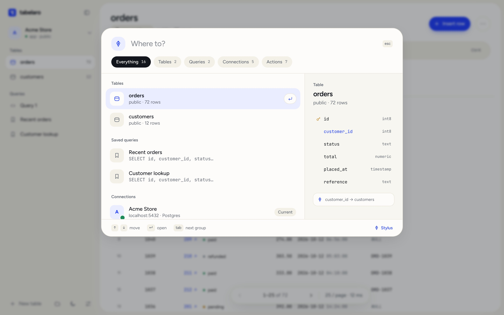
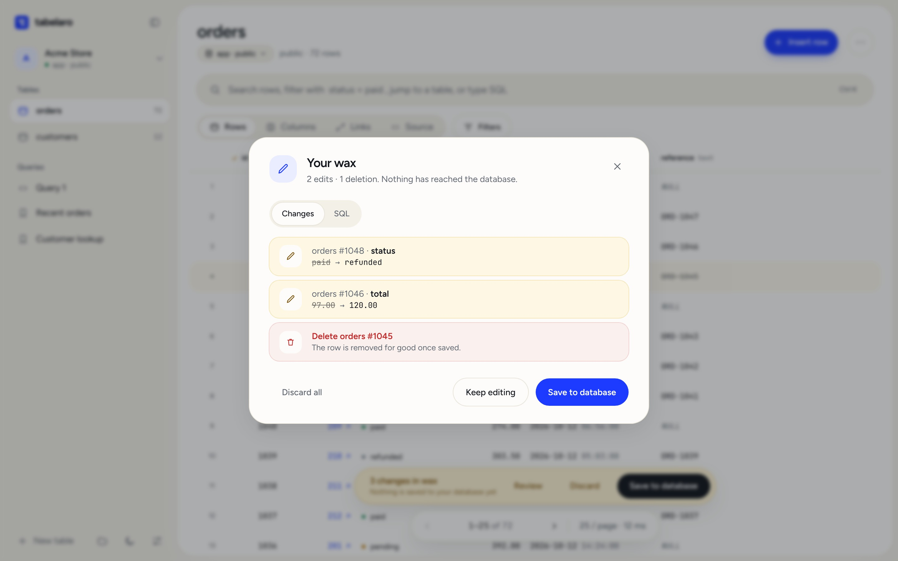
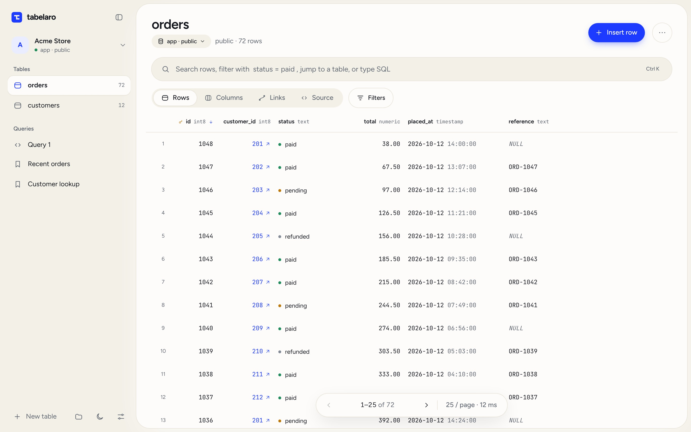

# Tabelaro

A free database client for macOS. PostgreSQL, MySQL/MariaDB and SQLite, with **no account and no telemetry**. Nothing leaves your machine.

**Website:** https://tabelaro.com



## Install

```sh
curl -fsSL https://tabelaro.com/install.sh | bash
```

Or with Homebrew:

```sh
brew install --cask tabelaro/tabelaro/tabelaro
```

Or download the DMG from [tabelaro.com](https://tabelaro.com). Requires macOS 11 or later.

## What makes it different

- **Stylus** (`⌘K`): jump to any table or column from one search box.
- **Wax**: edits stay as drafts until you decide to commit them. See exactly what will change first.
- **Threads**: follow relationships between tables without writing joins by hand.
- **Peek**: look at a table's columns and relationships without opening it.
- **No account, no telemetry**: install it and use it.





## Free, not open source

Tabelaro is free to use. The source code is not public. It is built and maintained by one developer.

## Notes

Tabelaro is not signed or notarized, so macOS may warn the first time you open a manually downloaded copy. The `curl` and Homebrew installs handle this for you. If you download the DMG yourself, right-click the app and choose **Open** once.

## Feedback

Bugs, ideas and questions: feedback@tabelaro.com or open an issue here.
